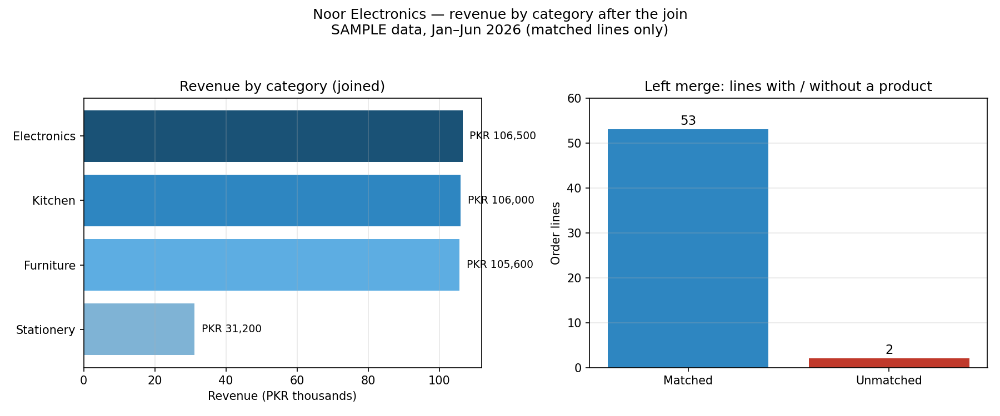

# Mini #22 — Python pandas Merging, Joining & Lookup Pack

**Status:** built, verified — published 22 Nov 2026

**SAMPLE / DEMO data only.** Fictional store, fictional sales,
fictional numbers. Never claimed as real client work.

The joins companion to Mini #19's groupby pack and Mini #21's
time-series pack: the same "Noor Electronics" shop as Mini #1 /
#3 — 32 clean orders, 52 clean lines, PKR 346,800, Jan–Jun 2026 —
now with the mess planted on purpose: a duplicate product key, a
duplicate customer key, a string customer key (`CUST-05`), two
orphan product keys (`99`, `P-03`), a duplicated monthly line, an
orphan return and an orphan manager. Ten pandas techniques, one
per file, each answering a question a working analyst asks every
week: what matched, what didn't, what got duplicated, and what
did the join do to my totals? Every number is recomputed
independently from the raw CSVs by `src/checks.py`. This pack is
the skill base for Flagship 2 (Job Market Intelligence Pipeline),
whose multi-source ingest is joins all the way down.

## Business question

"We joined the tables — can we still trust the totals?"

## What is inside

| File | What it does |
|---|---|
| `outputs/findings.md` | The teaching write-up: headline numbers + what each technique shows |
| `outputs/summary.json` | Every verified headline number, machine-readable |
| `outputs/revenue_by_category.png` | Revenue by category after the join + matched vs unmatched lines |
| `outputs/technique_01_inner_merge.csv` | Technique 1 — inner merge (orders × products, duplicate key live) |
| `outputs/technique_02_left_merge.csv` | Technique 2 — left merge, unmatched orders kept + orphan count |
| `outputs/technique_03_outer_merge.csv` | Technique 3 — outer merge, the never-sold product shows up |
| `outputs/technique_04_multikey_merge.csv` | Technique 4 — merge on two keys (returns on order + product) |
| `outputs/technique_05_indicator_merge.csv` | Technique 5 — merge with indicator (both / left-only / right-only) |
| `outputs/technique_06_concat_monthly.csv` | Technique 6 — concat of 6 monthly files + duplicate handling |
| `outputs/technique_07_map_lookup.csv` | Technique 7 — lookup with map() (category lookup) |
| `outputs/technique_08_merge_asof.csv` | Technique 8 — merge_asof (price in effect at order time) |
| `outputs/technique_09_self_join.csv` | Technique 9 — self-join (manager lookup) |
| `outputs/technique_10_validation_summary.csv` | Technique 10 — cross-join guard + row-count reconciliation |
| `data/raw/orders_SAMPLE.csv` | 33 orders (32 clean + 1 bad customer key) |
| `data/raw/order_items_SAMPLE.csv` | 55 order lines (52 clean + 3 planted bad-key lines) |
| `data/raw/products_SAMPLE.csv` | 10 product rows (9 products, id 2 listed twice) |
| `data/raw/customers_SAMPLE.csv` | 13 customer rows (12 customers, id 7 listed twice) |
| `data/raw/employees_SAMPLE.csv` | 6 employees (manager lookup + 1 orphan manager) |
| `data/raw/returns_SAMPLE.csv` | 5 returns (4 real + 1 orphan) |
| `data/raw/price_history_SAMPLE.csv` | 12 price rows (3 products changed price mid-year) |
| `data/raw/monthly/orders_2026-0X_SAMPLE.csv` | 6 monthly extracts, 53 rows stacked (line 22 twice) |
| `data/README.md` | Data dictionary + the full list of planted mess |
| `src/generate_data.py` | Regenerates all SAMPLE CSVs (deterministic, no randomness) |
| `src/run_techniques.py` | The 10 pandas techniques + summary.json + findings.md |
| `src/build_chart.py` | Builds the revenue-by-category chart |
| `src/checks.py` | Checks as code — every number re-derived from the raw CSVs |
| `requirements.txt` | pandas + matplotlib (`pandas>=2.0,<3`, `matplotlib>=3.7,<4`) |

## Key numbers (real numbers, recomputed from the CSVs)

| KPI | Value |
|---|---|
| Clean orders / clean lines | 32 / 52 (Jan–Jun 2026) |
| Clean revenue | PKR 346,800 (the Mini #1 total, reproduced exactly) |
| Raw order-lines file | 55 lines, PKR 366,800 (extra PKR 20,000 = 3 planted lines) |
| Inner merge (T1) | 59 rows from 53 matched lines; naive sum PKR 400,300 |
| Fan-out overstatement (T1) | PKR 51,000 (6 keyboard lines matched twice) |
| Left merge (T2) | 55 rows; 53 matched, 2 unmatched (lines 54, 55) |
| Matched revenue (T2) | PKR 349,300; unmatched value PKR 17,500 |
| Outer merge (T3) | 56 rows; 1 orphan product (Bluetooth Speaker, never sold) |
| Multi-key merge (T4) | 4 of 5 returns matched; PKR 43,500 returned |
| Net revenue after returns | PKR 303,300 |
| Indicator merge (T5) | 35 rows: 32 both, 1 left-only, 2 right-only |
| Concat (T6) | 53 rows stacked → 52 after dedupe; revenue PKR 346,800 |
| map() lookup (T7) | 53 of 55 lines mapped; mapped revenue PKR 349,300 |
| Revenue by category (T7) | Electronics PKR 106,500 · Kitchen PKR 106,000 · Furniture PKR 105,600 · Stationery PKR 31,200 |
| merge_asof (T8) | 41 lines at exact price, 11 differ; total diff PKR -100 |
| As-of revenue (T8) | PKR 346,700 vs PKR 346,800 at sale |
| Self-join (T9) | 4 of 6 employees have a manager |
| Cross-join guard (T10) | 55 × 9 = 495 combos > 200 cap — blocked, never materialised |
| Checks | see `python3 src/checks.py` |

## The 10 techniques

| # | Technique | pandas pattern | What it answers |
|---|---|---|---|
| 1 | Inner merge | `merge(how="inner")` | What survives when only matches count — and what the duplicate key costs? |
| 2 | Left merge | `merge(how="left")` | Which orders kept, which have no product — and how many? |
| 3 | Outer merge | `merge(how="outer")` | What never sold, and what never matched — both sides' orphans? |
| 4 | Multi-key merge | `merge(on=["order_id", "product_id"])` | Which returns land on a real order line? |
| 5 | Indicator merge | `merge(indicator=True)` | Which rows matched where — both, left-only, right-only? |
| 6 | Concat + dedupe | `concat()` + `drop_duplicates()` | Did the monthly files double-count anything? |
| 7 | map() lookup | `Series.map(dict)` | What category is each line — and what maps to nothing? |
| 8 | merge_asof | `merge_asof(by="product_id")` | What was the price in effect on the order date? |
| 9 | Self-join | table merged to itself | Who manages whom — and whose manager is missing? |
| 10 | Cross-join guard + validation | row-count reconciliation | Did any technique gain or lose a row silently? |

## What the pack teaches

1. **A join can multiply your numbers.** A duplicate key on the
   right turns 6 keyboard lines into 12 and inflates revenue by
   PKR 51,000 — with no error and no warning. Dedupe the key
   first, or merge with `validate="many_to_one"` and let pandas
   raise instead of silently doubling.
2. **An inner join deletes evidence.** Lines 54 and 55 vanish from
   technique_01 without a trace. If the question is "what is wrong
   with our data?", only a left or outer join — or the indicator —
   can answer it, because the inner join has already thrown the
   answer away.
3. **The indicator is the join's audit trail.** `both` 32,
   `left_only` 1, `right_only` 2: one line of output tells you
   order 33's customer key is broken and two customers never
   ordered. Run every production join with the indicator on, at
   least once.
4. **Concat is a union, not a join — and re-sent files duplicate
   rows.** The six monthly files stacked to 53 rows; dropping
   duplicates on `line_id` restores the true 52 and the true
   PKR 346,800. Never trust a stacked total before the dedupe.
5. **map() is silent about misses.** Unknown keys become NaN, not
   errors — lines 54 and 55 map to nothing, which is correct, but
   only if you then count the NaNs. A lookup that never checks its
   misses is a lookup that lies by omission.

## Verified numbers

| KPI | Value |
|---|---|
| Clean revenue | PKR 346,800 |
| Inner-merge naive sum / fan-out | PKR 400,300 / PKR 51,000 |
| Left-merge matched / unmatched | 53 / 2 lines |
| Orphan product | Bluetooth Speaker (never sold) |
| Returns matched / value | 4 of 5 / PKR 43,500 |
| Indicator (both / left / right) | 32 / 1 / 2 |
| Concat stacked / deduped | 53 / 52 rows |
| map() mapped / unmapped | 53 / 2 lines |
| merge_asof exact / differ / total diff | 41 / 11 / PKR -100 |
| Self-join matched managers | 4 of 6 |
| Cross-join guard | 495 > 200, blocked |
| Checks | see `python3 src/checks.py` |

Verification: `python3 src/checks.py` — every headline number is
recomputed from the raw CSVs with the standard library only (no
pandas) and compared against every output file: row counts and
revenues per technique, the fan-out multiset, the orphan lists,
the effective price of all 52 as-of lines, the manager of all 6
employees, the validation summary against summary.json, the key
numbers in findings.md and in this README, the chart PNG's source
data, and the generator re-run byte-compared for determinism (see
`src/checks.py`).

## How to run it

1. Install the dependencies: `pip install -r requirements.txt`.
2. Read `outputs/findings.md` — that is the deliverable.
3. To regenerate the sample data: `python3 src/generate_data.py`.
4. To re-run the analysis: `python3 src/run_techniques.py`.
5. To rebuild the chart: `python3 src/build_chart.py`.
6. To check it: `python3 src/checks.py`.
7. To practise on your own data: replace the raw CSVs (same
   columns) and re-run steps 4–6 only — do NOT re-run step 3, it
   regenerates the sample data and would overwrite your files.

## Two traps this pack teaches

- **A duplicate key doubles your revenue.** The inner merge's
  naive sum is PKR 400,300, not PKR 346,800 — the extra PKR 51,000
  is six keyboard lines counted twice because product 2 is listed
  twice. The fix is one line: dedupe the key before you merge.
- **A bad key looks like a missing row.** Order 33's customer
  (`CUST-05`) and line 55's product (`P-03`) are not absent — they
  are misspelled. A join that silently drops them reports a
  smaller business than the real one. Normalise key types and
  formats on both sides before merging, and count the unmatched.

## Limits

- **SAMPLE data only.** The store, the sales and the "findings"
  are invented to teach the techniques. The pandas patterns are
  real.
- **The mess is planted, not discovered.** Real messy data has
  unknown unknowns; this pack's orphans are listed in
  `data/README.md` so the checks can be exact.
- **One shop, six months, 55 lines.** The patterns scale — the
  row counts do not. On a million-row feed the same checks run,
  but the guard cap and the dedupe keys matter far more.

## Published

Published 22 Nov 2026: https://github.com/mhkh-stock/mini22-python-pandas-merging-joining
